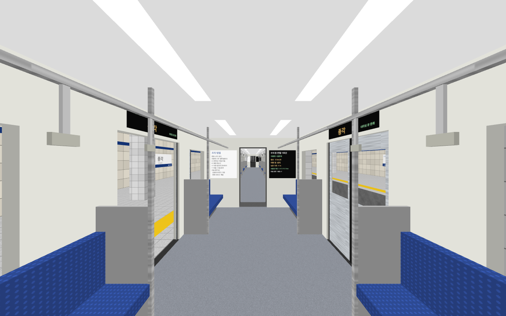
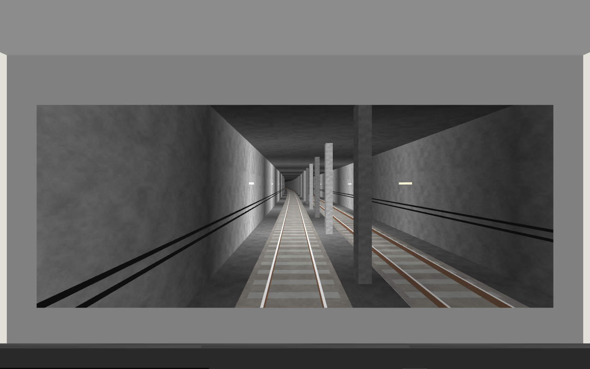
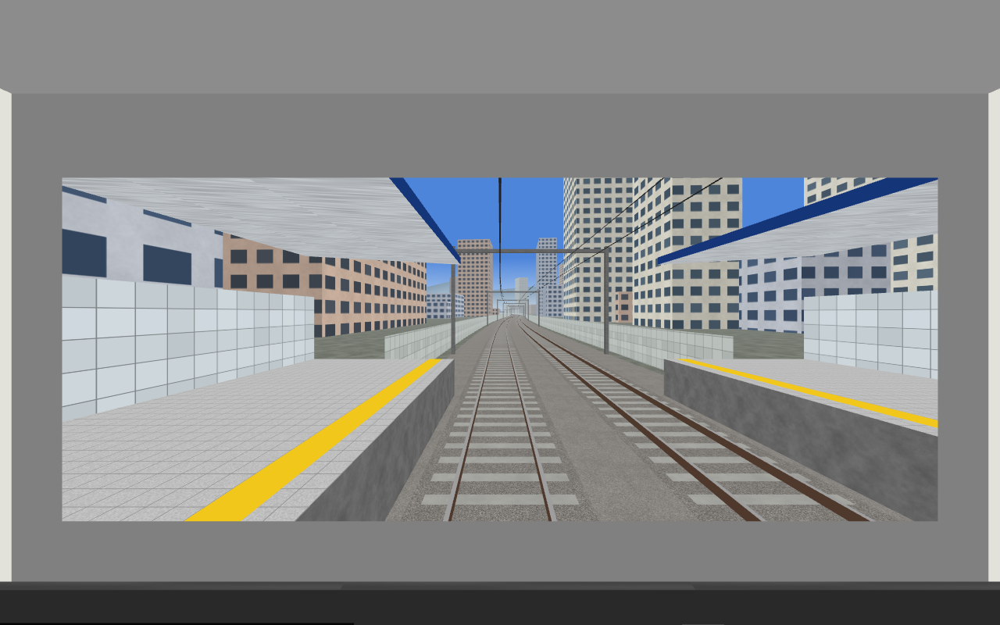

# 서울 1호선 VR (서울역 → 광운대)

메타 퀘스트용 VR 앱입니다. 수도권 전철 1호선 열차를 타고 서울역에서 광운대역까지
**실제 역 간 거리 그대로**(총 13.3km, 15개 역) 달립니다.

- 설치 파일: [`dist/seoul-line1-vr.apk`](dist/seoul-line1-vr.apk)
- 대상 기기: Meta Quest 2 / Pro / 3 / 3S (OpenXR)

| 객실 | 운전실 (지하 구간) | 운전실 (지상 구간) |
| --- | --- | --- |
|  |  |  |

위 그림은 PC에서 같은 렌더링 코드를 돌려 찍은 것입니다(`desktop/` 참고).

## 들어 있는 것

- 서울역~청량리 지하 구간, 청량리~회기 사이에서 지상으로 나오는 구간, 회기~광운대 지상 구간
- 15개 역 승강장과 역명판(역 번호, 앞뒤 역 표시)
- 10량 열차: 객실을 걸어서 옮겨 다닐 수 있고 맨 앞 운전실에서 전방을 볼 수 있습니다
- 1호선처럼 좌측통행, 역마다 정차해서 왼쪽 문이 열립니다
- 객실 안내 표시기(이번 역/다음 역, 남은 거리), 노선도, 속도·주행 거리 표시
- 광운대에 도착하면 반대 방향 열차로 바뀌어 서울역으로 돌아옵니다
- 주행 소리, 레일 이음매 소리, 출입문 차임

## 설치

1. 퀘스트에서 개발자 모드를 켭니다(메타 Horizon 모바일 앱 → 기기 설정 → 개발자 모드).
2. PC에 연결하고 `adb install -r dist/seoul-line1-vr.apk` 를 실행하거나, SideQuest로 APK를 설치합니다.
3. 퀘스트의 앱 목록에서 **알 수 없는 출처** → **서울 1호선 VR** 을 실행합니다.

## 조작 (터치 컨트롤러)

| 입력 | 동작 |
| --- | --- |
| 왼쪽 스틱 | 걷기 (보는 방향 기준) |
| 오른쪽 스틱 좌우 | 30도씩 방향 돌리기 |
| A | 운전실 ↔ 객실 이동 |
| B | 배속 바꾸기 (1 → 2 → 4 → 8배) |
| X | 다음 역으로 건너뛰기 (종착역에서는 바로 회차) |
| Y | 자동 / 수동 운전 |
| 오른쪽 트리거 | 수동 운전 중 가속 |
| 왼쪽 트리거 | 수동 운전 중 제동 |

컨트롤러 없이도 열차는 자동으로 운행합니다. 1배속 기준 편도 약 22분입니다.

## 거리 자료

역 간 거리는 영업거리 기준입니다. 서울역~청량리(지하 서울 구간)는 합계 7.8km,
청량리~광운대는 경원선 거리표를 따랐습니다.

| 구간 | km | 구간 | km |
| --- | --- | --- | --- |
| 서울역 → 시청 | 1.1 | 신설동 → 제기동 | 0.9 |
| 시청 → 종각 | 1.0 | 제기동 → 청량리 | 1.0 |
| 종각 → 종로3가 | 0.8 | 청량리 → 회기 | 1.4 |
| 종로3가 → 종로5가 | 0.9 | 회기 → 외대앞 | 0.8 |
| 종로5가 → 동대문 | 0.8 | 외대앞 → 신이문 | 0.8 |
| 동대문 → 동묘앞 | 0.6 | 신이문 → 석계 | 1.4 |
| 동묘앞 → 신설동 | 0.7 | 석계 → 광운대 | 1.1 |

선로의 방향은 역 좌표에서 구했고, 역 사이 선로 길이가 위 거리와 정확히 같아지도록
곡선을 맞췄습니다(`track.cpp`). 거리와 역 순서는 실제와 같지만, 곡선의 정확한 모양,
선로의 높낮이, 주변 건물과 역 내부 모습은 실제를 본뜬 것이 아니라 단순화해서 만든 것입니다.

## 빌드

Android SDK(플랫폼 34, 빌드 도구 34), NDK 27.2.12479018, CMake 3.22.1, Gradle 8.x, JDK 17 이상이 필요합니다.

```sh
export ANDROID_HOME=/path/to/android-sdk
gradle :app:assembleRelease
# 결과: app/build/outputs/apk/release/app-release.apk
```

APK는 저장소에 들어 있는 사이드로드용 키(`sideload.keystore`)로 서명합니다. 스토어 배포용 키가 아닙니다.

화면 글자를 바꾸면 글꼴 아틀라스를 다시 만들어야 합니다.

```sh
python3 tools/gen_font.py /usr/share/fonts/truetype/nanum/NanumSquareB.ttf
```

### 헤드셋 없이 장면 확인하기

`desktop/` 에는 같은 장면 코드를 소프트웨어 OpenGL ES로 그려 PNG로 저장하는 시험 도구가 있습니다
(리눅스, `libegl-dev`, `libgles-dev`, Mesa 필요).

```sh
desktop/build.sh
cd desktop
./line1_desktop out.png --station 2 --extra 400 --car 0 --z -10.75   # 종각을 지나 400m, 운전실
./line1_desktop out.png --steps 72000                                # 1000초 운행 후 장면
```

## 코드 구성

| 파일 | 내용 |
| --- | --- |
| `app/src/main/cpp/track.cpp` | 역 자료와 선로 중심선 |
| `app/src/main/cpp/world.cpp` | 터널, 승강장, 지상 풍경 (40m 단위로 생성) |
| `app/src/main/cpp/train.cpp` | 객실과 운전실 모델 |
| `app/src/main/cpp/app.cpp` | 운행 시뮬레이션, 표시기, 렌더링 |
| `app/src/main/cpp/main_android.cpp` | OpenXR / 안드로이드 진입점 |
| `app/src/main/cpp/audio_android.cpp` | 소리 합성 |

글꼴은 나눔스퀘어(SIL Open Font License)를 아틀라스 이미지로 만들어 넣었습니다.
`stb_image.h` 는 퍼블릭 도메인 / MIT 라이선스입니다.
